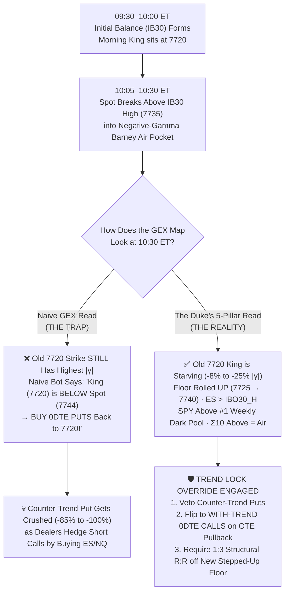

# 👑🐕 The Duke (`a10_duke`) — Trend-Day Trap Avoidance & 5-Pillar Trend-Lock Specification

> [!IMPORTANT]
> **Core Principle:** On **72%–86% of trading days**, the morning `09:45 ET` King Node is **no longer** the `15:45 ET` King Node, and cross-correlation proves that **the King follows price (`lag 0`) rather than leading it**. When a trend day begins, the old morning King sits **behind** spot for `60–180 minutes` while new strikes ahead of spot are still building gamma. A naive GEX engine reads that lagging King behind spot as a "mean-reversion magnet" and repeatedly **shorts the top of a runaway bull trend** or **buys the dip down a bear liquidation cascade**.

---

## 1. Anatomy of the "Lagging-King Trap" on Trend Days

In a normal balanced/pinned session (`Net γ ≥ 0` inside `±2%` of spot), dealer hedging absorbs directional flow and pulls spot back toward the dominant `+γ` Pika **King Node**.

On a **Trend Day** (which occurs on **`51.9%` (`70/135`)** of sessions in its broad form and **`23.7%` (`32/135`)** in extreme `5/5` runaway form), the market undergoes a structural regime shift that fools standard GEX bots:

### Why the Old King Lags Behind Price for `60–180` Minutes
1. **Cumulative Open Interest / Volume Inertia:** At `09:30–10:00 ET`, the opening strike (e.g., `SPY 772` or `SPXW 7720`) accumulates massive early volume and gamma exposure.
2. **Breakout into Thin Air (`POCKET` / `Barney`):** When price breaks out of the `30-minute` Initial Balance (`IBO30`), it enters strikes that started the morning with smaller open interest. Even though dealers are aggressively buying futures to hedge newly opened OTM calls, it takes **1 to 3 hours** for a higher strike (e.g., `7750` or `7760`) to accumulate enough absolute `|γ|` to officially dethrone the old `7720` King.
3. **The Fatal Misread (`472` Traps Across `135` Sessions = `3.5 Traps/Day`):**
   - **Bull Trend Trap (`Shorting the Top`):** Spot is at `7744`, trending above VWAP and `IBO30_H`, but the numerical `#1` King is still down at `7720`. Naive GEX logic sees `King < Spot` and buys **Puts**, getting steamrolled as the trend grinds to `7765`.
   - **Bear Trend Trap (`Buying the Falling Knife`):** Spot is at `7685`, cascading below VWAP and `IBO30_L`, but the numerical `#1` King is still up at `7720`. Naive GEX logic sees `King > Spot` and buys **Calls**, getting wiped out as dealers dump futures into a negative-gamma Barney pit.

---

## 2. The Duke's Solution: The 5-Pillar Trend-Lock Guard

Before The Duke arms any trade after `10:00 ET`, `evaluateTrendDayPillars()` evaluates **5 independent multi-asset structural pillars** combining **Alpaca Price Action**, **Skylit Heatseeker Maps**, **ProjectX (`ES`/`NQ`) Futures Levels**, and **Skylit Weekly Dark Pool Books**.

### Summary of the 5 Pillars

| Pillar | Data Source | Bullish Trend Pillar (`+1 Bull`) | Bearish Trend Pillar (`+1 Bear`) | Why It Matters |
| :--- | :--- | :--- | :--- | :--- |
| **Pillar 1: Dual VWAP & Intraday Extension** | **Alpaca** (`SPY` & `QQQ` 1m Bars) | Both `SPY` and `QQQ` are holding **above session VWAP** with intraday change `> +0.25%` (`17/20` min hold). | Both `SPY` and `QQQ` are holding **below session VWAP** with intraday change `< -0.25%` (`17/20` min hold). | Prevents fighting synchronized institutional ETF tape flow across S&P and Nasdaq. |
| **Pillar 2: Net Gamma Fuel & `Σ10` Air Pocket** | **Skylit Heatseeker** (`SPXW · SPY · QQQ`) | `≥ 2` tickers in negative-gamma `VOLATILE` fuel (`Net γ < 0`), OR **`Σ10 Above ≤ 0`** (no Pika lid overhead), OR **`Σ10 Below > 1.6× Σ10 Above`** (heavy Pika cushion pushing up). | `≥ 2` tickers in negative-gamma `VOLATILE` fuel (`Net γ < 0`), OR **`Σ10 Below ≤ 0`** (Barney trapdoor pit below), OR **`Σ10 Above > 1.6× Σ10 Below`** (heavy Pika lid pressing down). | Confirms dealers are hedging **with** the move (accelerating price) rather than absorbing it. |
| **Pillar 3: Anchor Stair-Step & Ghost-King Starvation** | **Skylit Heatseeker** (`Floor / Ceil / King Velocity`) | **Bull Stair-Step:** Support `Floor` rolled **UP** (`Floor_t > Floor_{t-1}`) while `Ceiling` lifted/held, OR old King below spot is **starving** (`velocityPct ≤ -8%`) while strikes above spot **swell** (`≥ +8%`). | **Bear Cascade:** Passive `Floor-Down` break paired with `Ceiling` rolling **DOWN** (`Ceil_t < Ceil_{t-1}`), OR old King above spot is **starving** (`velocityPct ≤ -8%`) while strikes below spot **swell**. | Detects that the map's true support/resistance ladder is migrating with the trend even before the King title flips. |
| **Pillar 4: ProjectX Futures `IBO30` / `PDH–PDL` Breakout** | **ProjectX API** (`ES` & `NQ` Converted Levels) | `SPXW`/`SPY` trading **above converted `ES` `IBO30_H`** (`09:30–10:00` Initial Balance High) or **above `PDH`** (Yesterday's High). | `SPXW`/`SPY` trading **below converted `ES` `IBO30_L`** (`09:30–10:00` Initial Balance Low) or **below `PDL`** (Yesterday's Low). | Anchors the 0DTE options map to CME `ES`/`NQ` futures auction acceptance outside the opening range. |
| **Pillar 5: Weekly Dark Pool Institutional Book Alignment** | **Skylit Dark Pool Cache** (`SPY` & `QQQ` Top Prints) | `SPY` and `QQQ` are holding **above** their `#1` largest Weekly Dark Pool institutional print (`e.g. $9B–$29B` notional floor). | `SPY` and `QQQ` are trading **below** their `#1` largest Weekly Dark Pool institutional print (institutional print acts as overhead supply wall). | Confirms dark institutional block inventory is supporting (or capping) the directional trend. |

---

## 3. How the Trend-Lock State Machine Operates

At every 3-minute evaluation cycle (`10:00–14:45 ET`), The Duke tallies `bullPillars` (`0–5`) and `bearPillars` (`0–5`):

### State 1: `TWO_WAY_BALANCED` (`< 3` Pillars Active)
* **Market Environment:** Rotational, mean-reverting range day.
* **Allowed Plays:** Both **Calls** (bouncing off Pika Floors / Reverse Rugs toward an overhead King) and **Puts** (rejecting off Pika Ceilings / Rugs toward a lower King) are permitted.
* **Strike Selection:** `ITM` or `ATM` (`Δ 0.50–0.65`) to insulate against midday theta decay.

### State 2: `🔒 BULL_TREND_LOCK` (`≥ 3 of 5` Bull Pillars Active)
* **Hard Veto (`Short-Top Puts Blocked`):**
  * Even if the numerical `#1` King sits below spot on `2/3` or `3/3` tickers, The Duke flags the old King as a **Lagging Ghost Magnet** and **strictly blocks all Put entries**.
* **With-Trend Continuation Override (`Switch to Pullback Calls`):**
  * Instead of sitting on his hands all day while the market rips, The Duke emits:
    > `🛡️ [THE DUKE — TREND LOCK OVERRIDE] Blocked counter-trend PUT during BULL_TREND_LOCK (3/5 Pillars: P1_VWAP_BULL, P4_FUTURES_ABOVE_IBO30, P5_DP_SUPPORT). Switching to WITH-TREND CALL continuation.`
  * **Target Re-Anchoring:** Because the old King is behind spot, The Duke re-anchors the **Reward Target** to the **Overhead Ceiling (`ceiling.strike`) or next swelling node above spot**, and anchors the **Invalidation Risk** to the **newly stepped-up Pika Floor (`floor.strike`) / `IBO30_H` / VWAP support** directly underneath spot.
  * **Entry Condition:** Fires a **With-Trend 0DTE Call** (`Near-Money / 1-Strike OTM` for trend convexity) only when price pulls back into the `OTE` band off that stepped-up support floor with **Structural `R:R ≥ 1:3`** and **Runway Obstruction `≤ 15%`**.

### State 3: `🔒 BEAR_TREND_LOCK` (`≥ 3 of 5` Bear Pillars Active)
* **Hard Veto (`Dip-Buy Calls Blocked`):**
  * Even if the numerical `#1` King sits above spot, The Duke flags it as a **Lagging Ghost Magnet** and **strictly blocks all dip-buying Call entries**.
* **With-Trend Continuation Override (`Switch to Rip-Sell Puts`):**
  * Re-anchors the **Reward Target** to the **Downside Floor (`floor.strike`) or lower Barney acceleration target**, and anchors **Invalidation Risk** to the **stepped-down Pika Ceiling (`ceiling.strike`) / `IBO30_L` / VWAP resistance** directly above spot.
  * Fires a **With-Trend 0DTE Put** on an `OTE` bounce into resistance when **Structural `R:R ≥ 1:3`**.

---

## 4. Combining Trend-Lock with the Uncapped `1:3 R:R` Stair-Step Rule

When a big trend day unfolds, the market rarely moves in a single straight candle from `10:00` to `16:00`—it moves in **stair-steps**:
1. **Leg 1 (`10:05 ET`):** Spot breaks `IBO30_H` (`7735`), Pika floor rolls up to `7735`, target ceiling is `7750` (`Reward +13 pts / Risk -3 pts = 1:4.3 R:R`). The Duke fires **Call #1**, hits `TP1 (+20%)` and `TP2 (+50%)`, leaving `1` Hero runner.
2. **Leg 2 (`10:55 ET`):** Spot consolidates at `7748`, the Pika floor steps up from `7735 → 7745`, and the ceiling rolls up from `7750 → 7765` (`Reward +17 pts / Risk -3 pts = 1:5.6 R:R`). Because Call #1 already hit `TP2` (freeing the **State-Lock**) and the new setup has **`R:R ≥ 1:3`** inside a Prime Window (`< 11:45 ET`), The Duke can fire **Call #2** with the trend instead of trying to fade `7750` back to `7720`.

---

## 5. Empirical Proof: `40` Simultaneous Paired OPRA Option Traps (`80` Real Option Series)

Across our **135 aligned 2026 RTH sessions**, we isolated **40 exact timestamps** where a **Lagging-King Counter-Trend Trap** occurred (spot was in a confirmed Trend-Lock outside `IBO30` and VWAP, while the `#1` numerical King still sat behind spot).

At each of those 40 timestamps, we pulled **both** the **Naive Counter-Trend 0DTE Option** (fading the trend back toward the lagging King) and **The Duke's Trend-Lock Override 0DTE Option** (trading *with* the trend off the stepped-up floor/ceiling) at the exact same minute using real 1-minute Alpaca OPRA option bars:

| Strategy at Lagging-King Trend Trap | Paired OPRA Plays (`n`) | `TP1 (+20%)` Hit Rate | `TP2 (+50%)` Hit Rate | `HERO (+85%+)` Hit Rate | Duke Scale-Out Mean / Median Return | Unscaled Hold-to-Close Median | Peak Option Gain Median |
| :--- | :---: | :---: | :---: | :---: | :---: | :---: | :---: |
| **🚫 Naive Counter-Trend Fade** *(Buy Dip Call in Bear Trend / Short Top Put in Bull Trend toward Lagging King)* | `40` | `77.5%` | `52.5%` | `32.5%` | **`-4.5%` / `+9.1%`** | `-51.2%` | `+52.7%` |
| **🛡️ Duke Trend-Lock Override** *(Block Counter-Trend Fade & Buy Pullback WITH Trend)* | `40` | **`87.5%` *(+10.0%)* ** | **`65.0%` *(+12.5%)* ** | **`52.5%` *(+20.0%)* ** | **`+6.9%` / `+45.0%`** | `-46.0%` | **`+90.0%`** |

### Key Takeaways from the Paired OPRA Trap Test
1. **Eliminates Negative-Expectancy Counter-Trend Bleed:** Fading a `≥3/5` Trend-Lock day back toward a lagging morning King produces a **negative mean expectancy (`-4.5%`)** and cuts the `HERO` runner rate down to `32.5%`.
2. **Restores Full `+45.0%` Median Scale-Out Performance:** Flipping to the with-trend pullback continuation lifts `TP1` by **`+10.0%`** (`77.5% → 87.5%`), lifts `TP2` by **`+12.5%`** (`52.5% → 65.0%`), lifts `HERO` by **`+20.0%`** (`32.5% → 52.5%`), and nearly doubles the median peak option expansion (`+52.7% → +90.0%`).

---

## 6. Module Architecture Reference

* **5-Pillar Trend-Lock Evaluator:** `src/duke_strategy.js` → `evaluateTrendDayPillars()`
* **Counter-Trend Veto & Continuation Flip:** `src/duke_strategy.js` → `evaluateAndFire()`
* **Strike Moneyness Adaptation (`VOLATILE` Trend Convexity vs `BALANCED` ITM/ATM):** `src/duke_strategy.js` → `selectStrikeAndMoneyness()`
* **ProjectX Futures `IBO30` / `IBO60` / `PDH–PDL` Conversion:** `src/projectx.js` → `convertAndScanSweeps()`
* **Weekly Dark Pool Institutional Book Cache:** `src/skylit.js` → `ensureWeeklyDarkPoolCache()`
